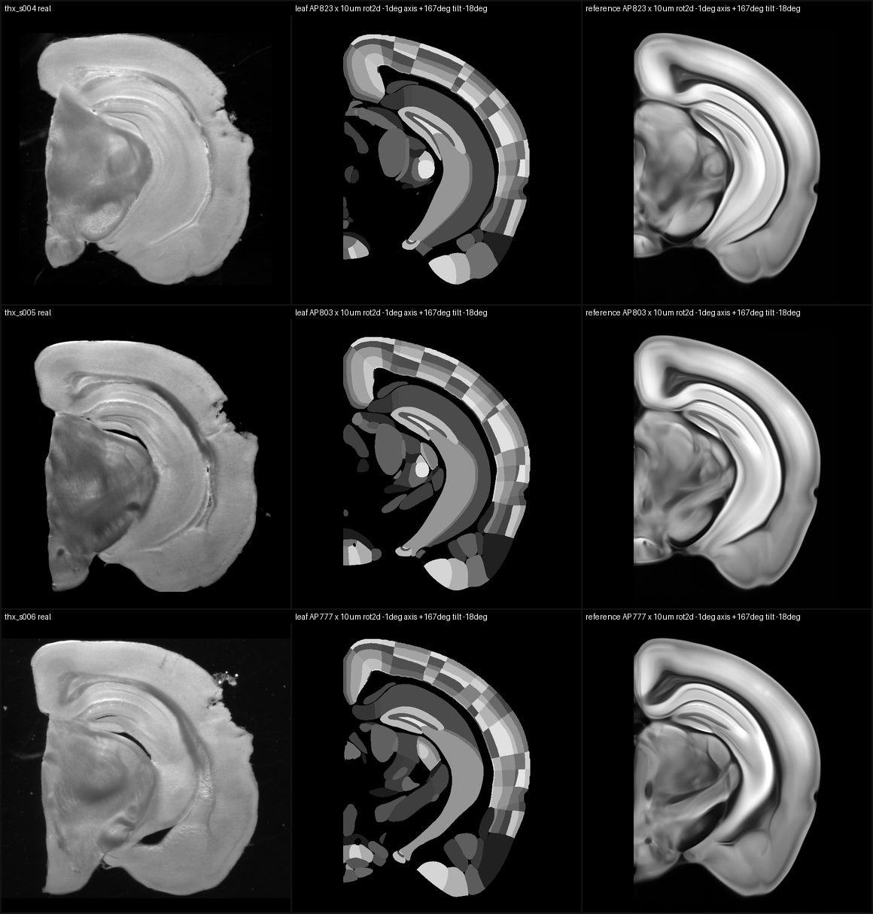

# AutoAtlas — registration-first brain atlas research

**Selected code and an authorized qualitative illustration for private review.**
This repository is a small, portable extraction of real AutoAtlas components,
with a generated CPU example. It does not include a trained model, atlas
volumes, private slice datasets, or the complete registration application.

AutoAtlas investigates registration of mouse-brain slice series to the Allen
Mouse Brain Common Coordinate Framework. The research question is whether
internal anatomy transfers across sources, rather than relying on source
appearance or the tissue outline.

Development records are traceable to **April 2026**; the first Git commit is
dated **May 5, 2026**. The precise project start day is unknown.

## Problem and design

The research pipeline proposes candidate 3D planes, compares internal-structure
evidence, jointly reasons over slice order and cutting pose, and abstains when
the evidence is insufficient. Evaluation keeps prediction separate from truth
scoring and uses held-out sources and edge-damage controls.

This extraction contains two actual numerical components:

- **Plane sampler:** batched axis/tilt and in-plane rotation using PyTorch
  grid_sample, with explicit volume-axis and hemisphere conventions.
- **Sequence decoder:** a truth-free dynamic program over supplied candidate
  costs, including AP reversal, large-step and adjacent-pose penalties.

The plane sampler does not infer the pose by itself. The decoder does not
produce learned descriptors or calibrated probabilities. See
[architecture](docs/architecture.md) and [evaluation status](docs/evaluation.md).

## Contribution and development process

Yanbo Jiang led the research framing, registration architecture, controls,
acceptance criteria, visual quality review and supervision of AI-assisted
development. Coding agents assisted substantial implementation, tests,
diagnostics and documentation, with separate model-assisted review in the
research workflow. Git authorship alone does not establish hand-written code
shares, sole invention, or an exact human/agent contribution percentage.

## Quick start

Use Python 3.10 or later, NumPy and a PyTorch build appropriate for your system.
The included example explicitly uses the CPU.

~~~sh
python -m venv .venv
# Activate the environment using your shell's normal command.
python -m pip install -e .
python examples/demo.py --out demo-output
python -m unittest discover -s tests -v
~~~

The example builds a tiny procedural volume and a synthetic candidate-cost
table. It writes sampled-plane summaries and selected sequence rows. These
are software illustrations, not results on real brains or an accuracy
benchmark. No data download, pretrained weights, external service, or GPU
is required by the example.

For tests without installing this package, put src on PYTHONPATH.

## Authorized qualitative example

The columns show a real section, the atlas structure template, and the atlas
reference image at the selected plane. This image retains the last three rows
of an earlier seven-section montage, preserving all three columns and pose
headers: AP indices **823, 803 and 777**, shared cutting axis **+167°**, tilt
**−18°**, and in-plane rotation **−1°**. AP indices use 10-micrometre coronal
index units.

This is a specifically authorized, historical qualitative illustration.
Three in-house series received visual QC from one reviewer. Neither this image
nor the generated example establishes held-out accuracy or superiority to
another method.

## Current scientific status

The full scientific acceptance gate remains unmet. There is no new accepted
AP100 result from the current pending experiments. AP100 is the fraction of
predictions within 100 micrometres of the adopted AP label.

As of the November 8, 2026 research snapshot:

- A source-comparison unit's control-arm optimization completed 40 epochs and
  1,160 committed updates, and its two exports completed. A schedule-identifier
  validation mismatch then prevented artifact admission. The repair awaits
  independent review and retained-artifact validation; that unit's treatment
  arm and paired scoring have not run.
- A separate edge-diagnostic prediction completed, but its score stage remains
  held pending independent review of a repaired identity guard.
- An earlier fixed internal-domain diagnostic did not support that particular
  intervention. This is not a definitive negative claim about an entire
  mechanism family.

These are separate units. Local engineering tests, completed training,
predictions and screenshots do not establish scientific acceptance or an
improvement in registration accuracy.

## Related work and access

[DeepSlice](https://doi.org/10.1038/s41467-023-41645-4) established fully
automatic mouse-brain section registration.
[QuickNII](https://doi.org/10.1371/journal.pone.0216796) supports user-guided
registration of serial sections at arbitrary angles. Early DeepSlice
initialization was explored qualitatively; a controlled comparison on real
sections remains planned. AutoAtlas has no demonstrated superiority to
DeepSlice.

See [provenance and licensing](docs/provenance.md), [validation](docs/validation.md),
and [LICENSE](LICENSE). This repository is kept private; synchronization does
not authorize broader public access.
